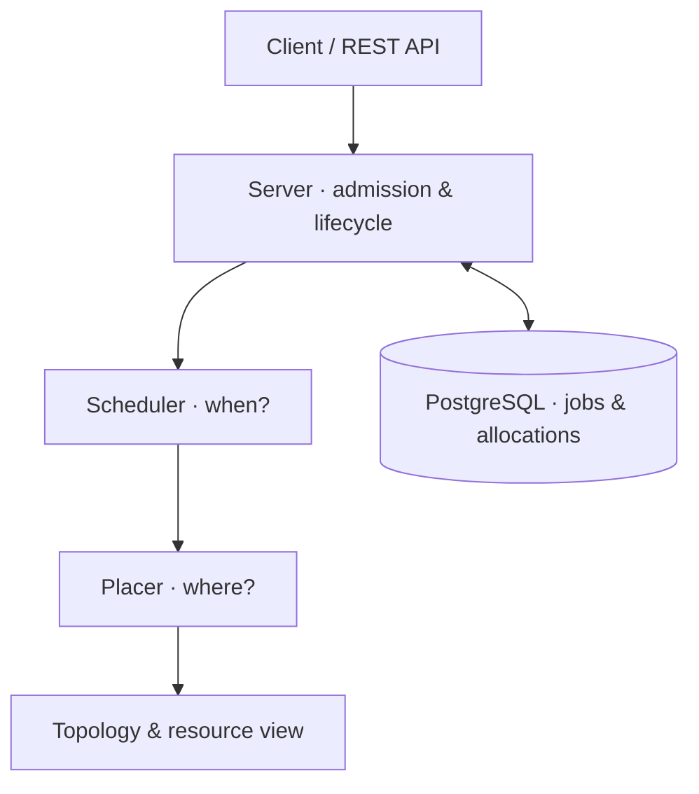

<div align="center">

# Topology-Aware Scheduling & Placement

**An experimental workload-management system for exploring how jobs are scheduled, resources are allocated, and cluster topology shapes placement decisions.**

[](https://github.com/labo-man002/job-scheduler/actions/workflows/ci.yml)


Python · FastAPI · PostgreSQL · React · TypeScript

</div>

<p align="center">
  
</p>

<p align="center">
  <a href="#why-this-project">Why</a> ·
  <a href="#what-works-today">Capabilities</a> ·
  <a href="#architecture">Architecture</a> ·
  <a href="#getting-started">Get started</a> ·
  <a href="#where-its-going">Roadmap</a>
</p>

## Why this project?

A scheduler decides **when** a job gets a chance to run. A placer decides **where** its resources should come from. In a real cluster, that second decision is shaped by resource availability, ownership, reservations, and the physical arrangement of the machines.

This project keeps those concerns separate and inspectable. It models the path from job submission to a concrete, persisted allocation, with interchangeable scheduling and placement strategies and an interactive view of the cluster. It grew out of practical questions about scheduling and resource management in topology-constrained HPC systems.

The longer-term goal is a reproducible **what-if environment**: change a workload, cluster configuration, or policy and examine the consequences for queueing, utilization, fragmentation, and communication locality. The current code is a working workload-management prototype and the foundation for those experiments—not a production orchestrator or a validated distributed-training simulator.

## What works today

| Area | Current implementation |
| --- | --- |
| **Job lifecycle** | Submission, cancellation, completion, persisted state transitions, allocation records, and job-event history. |
| **Scheduling** | Per-cluster queues with FIFO and fixed-priority ordering; strict-order draining rather than backfilling. |
| **Resource placement** | Multi-resource and multi-node allocations, with swappable Pack and Spread strategies. CPU and GPU are represented as allocatable resource units. |
| **Cluster topology** | Ring, 2D mesh, 2D torus, and 3D torus models; neighbor/distance queries and topology-based Pack/Spread placement. |
| **Allocation controls** | Institute-level quotas, time-bounded node reservations, and PostgreSQL row locking around allocation decisions. |
| **Interface** | Job submission and inspection, interactive cluster maps, resource details, and light/dark themes. |
| **GPU network fabric** | A separate in-memory leaf–spine domain model with switches, ports, links, operational states, constrained path queries, and read-only GPU candidate discovery. **Not yet connected to the live placer.** |

The distinction in the last row matters: GPU resources can be requested and allocated by the existing system, while network-aware GPU placement remains work in progress.

## Architecture



- **Server** receives requests, selects a cluster, enforces quotas and reservation rules, and owns job/allocation persistence.
- **Scheduler** determines which queued job to attempt next. Its ordering policy can change independently of placement.
- **Placer** filters eligible resource units and applies a placement policy against a topology view.
- **PostgreSQL** records jobs, resource ownership, allocations, and lifecycle events. Placement uses transaction-local, row-locked resource state to protect allocation consistency.

The current queue is **in-process and single-worker oriented**; it is not a distributed control plane. For the detailed model, see [architecture](docs/architecture.md), [schema](docs/erd.md), and the [design decisions](docs/decisions.md).

### A second topology model: GPU leaf–spine fabrics

The grid-based topology used by Pack/Spread is not enough to represent a GPU data-center network. A separate domain model now captures:

- Leaf and spine switches, typed switch ports, GPU servers, NICs, and physical links.
- Link capacity and latency, plus operational UP/DOWN state of devices and connections.
- Deterministic path discovery subject to minimum nominal link capacity and maximum path latency.
- Read-only candidate discovery that combines existing GPU availability with network-path feasibility.

This was introduced in [PR #86](https://github.com/labo-man002/job-scheduler/pull/86) and is documented in [GPU leaf–spine design](docs/gpu-leaf-spine.md). It **does not yet** persist fabric state, reserve bandwidth, model contention, or influence scheduler/placer allocation decisions.

## A look at the interface

| Clusters | Jobs |
| :---: | :---: |
|  |  |

| Job details | Submit a job |
| :---: | :---: |
|  |  |

<details>
<summary>Dark mode preview</summary>


</details>

## Getting started

You will need **Python 3.10**, **PostgreSQL**, and **Node.js / pnpm**. The CI configuration uses PostgreSQL 14, Node.js 24, and the pnpm version pinned in [`package.json`](package.json).

```bash
git clone https://github.com/labo-man002/job-scheduler.git
cd job-scheduler
```

### 1. Run the backend

Create a PostgreSQL database and a `.env` file in the repository root or `backend/` containing these settings:

```dotenv
DATABASE_HOSTNAME=localhost
DATABASE_PORT=5432
DATABASE_USERNAME=your_user
DATABASE_PASSWORD=your_password
DATABASE_NAME=your_database
```

Then, from the repository root:

```bash
cd backend
python3 -m venv .venv
.venv/bin/pip install -r requirements.txt
.venv/bin/alembic upgrade head
.venv/bin/uvicorn app.main:app --reload
```

### 2. Run the frontend

In a second terminal, from the repository root:

```bash
pnpm install
pnpm generate:api
pnpm --filter frontend dev
```

The typed API client is generated from the backend's OpenAPI schema. The frontend is served at [http://localhost:5173](http://localhost:5173) and needs the backend running to load application data.

### 3. Run the checks

```bash
# From backend/
.venv/bin/pytest -v

# From the repository root
pnpm --filter frontend test
pnpm --filter frontend lint
pnpm --filter frontend build
```

GitHub Actions also runs the backend checks with PostgreSQL and validates the frontend build, tests, and linting; see [CI workflow](.github/workflows/ci.yml).

## Where it's going

The main question is how **hardware topology and workload characteristics should influence allocation**—and how to evaluate competing decisions instead of assuming one heuristic is best.

Areas under active design or planned exploration:

1. **Connect fabric feasibility to placement.** Integrate GPU/server and network-path constraints into the scheduler–placer boundary while preserving transactional resource ownership.
2. **Build reproducible workload experiments.** Add a simulation clock, workload replay, and comparative metrics for waiting time, utilization, fragmentation, and throughput.
3. **Model communication costs more deeply.** Move beyond nominal path feasibility toward bandwidth reservation, contention, and communication-aware policies.
4. **Expand heterogeneous GPU topology.** Explore PCIe/NUMA affinity, NVLink/NVSwitch, InfiniBand/RoCE, and additional fabric shapes without discarding the existing mesh/torus models.

These are directions, not claims about implemented functionality or measured AI-workload speedups. Design discussion and feedback are welcome through [issues](https://github.com/labo-man002/job-scheduler/issues).

## Documentation

| Document | Focus |
| --- | --- |
| [Architecture](docs/architecture.md) | Scheduler–placer split, domain concepts, and class diagrams. |
| [Data model](docs/erd.md) | Persistence and allocation relationships. |
| [Design decisions](docs/decisions.md) | Modeling tradeoffs, invariants, and known open questions. |
| [GPU leaf–spine](docs/gpu-leaf-spine.md) | The standalone fabric model, API, guarantees, and deferred integration. |

---

<p align="center"><sub>Independent engineering project · exploring scheduling, placement, and topology-aware resource management.</sub></p>
