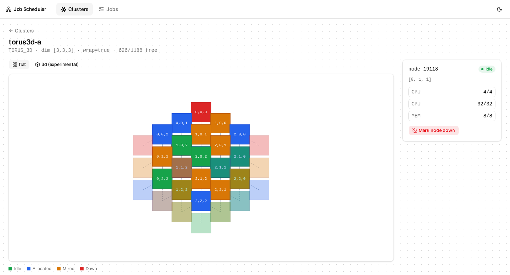
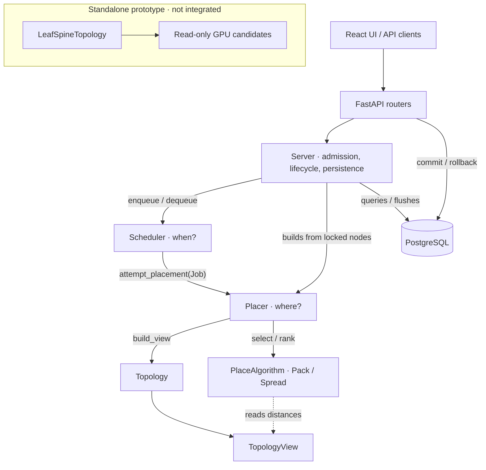
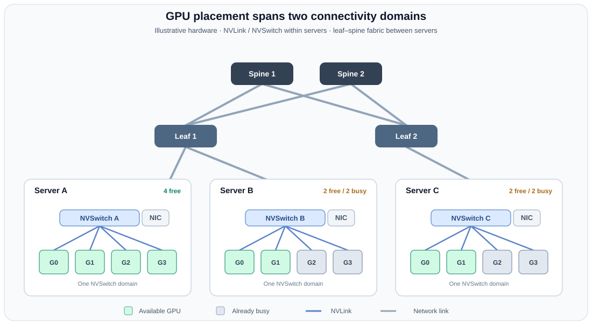
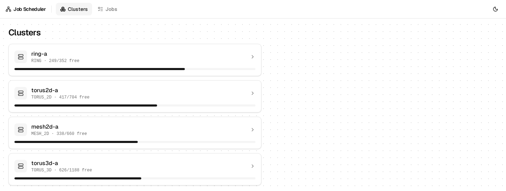
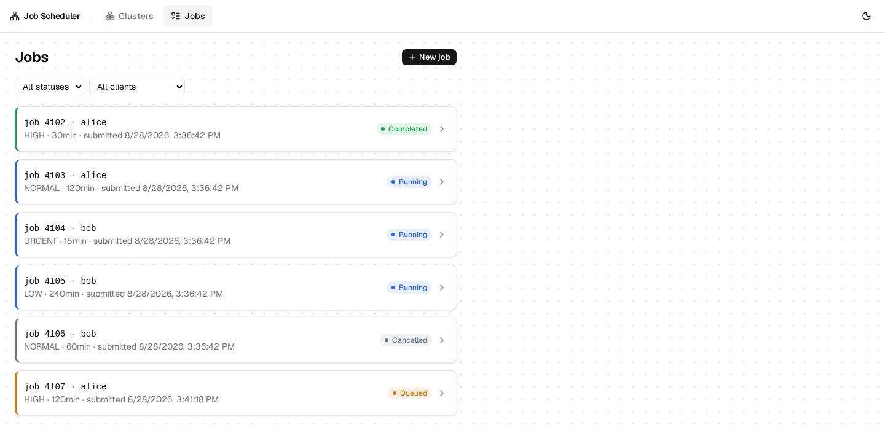
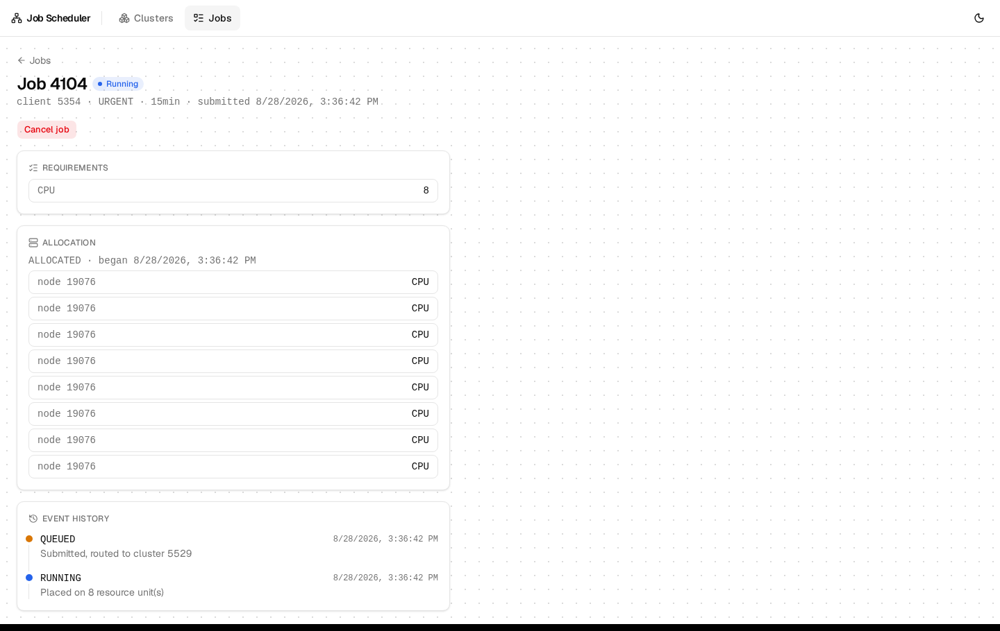
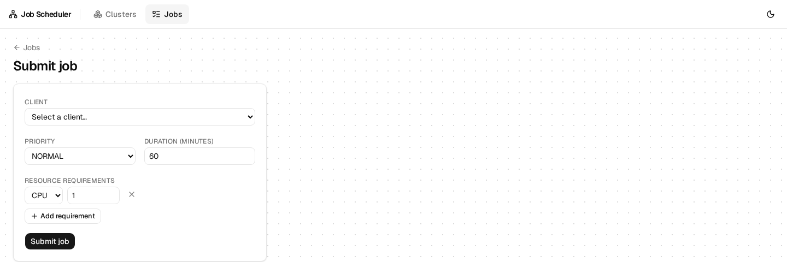
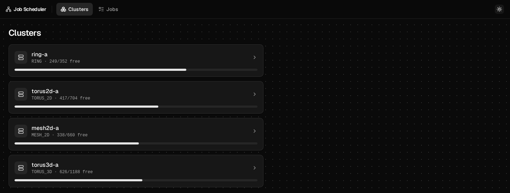

<div align="center">

# Topology-Aware Scheduling & Placement

**An experimental workload-management system for exploring how jobs are scheduled, resources are allocated, and cluster topology shapes placement decisions.**

[](https://github.com/labo-man002/job-scheduler/actions/workflows/ci.yml)


Python · FastAPI · PostgreSQL · React · TypeScript

</div>

<p align="center">
  
</p>

<p align="center">
  <a href="#why-this-project">Why</a> ·
  <a href="#what-works-today">Capabilities</a> ·
  <a href="#architecture">Architecture</a> ·
  <a href="#getting-started">Get started</a> ·
  <a href="#where-its-going">Roadmap</a>
</p>

## Why this project?

A scheduler decides **when** a job gets a chance to run. A placer decides **where** its resources should come from. In a real cluster, that second decision is shaped by resource availability, ownership, reservations, and the physical arrangement of the machines.

This project keeps those concerns separate and inspectable. It models the path from job submission to a concrete, persisted allocation, with interchangeable scheduling and placement strategies and an interactive view of the cluster. It grew out of practical questions about scheduling and resource management in topology-constrained HPC systems.

The longer-term goal is a reproducible **what-if environment**: change a workload, cluster configuration, or policy and examine the consequences for queueing, utilization, fragmentation, and communication locality. The current code is a working workload-management prototype and the foundation for those experiments—not a production orchestrator or a validated distributed-training simulator.

## What works today

| Area | Current implementation |
| --- | --- |
| **Job lifecycle** | Submission, cancellation, completion, persisted state transitions, allocation records, and job-event history. |
| **Scheduling** | Per-cluster queues with FIFO and fixed-priority ordering; strict-order draining rather than backfilling. |
| **Resource placement** | Multi-resource and multi-node allocations, with swappable Pack and Spread strategies. CPU and GPU are represented as allocatable resource units. |
| **Cluster topology** | Ring, 2D mesh, 2D torus, and 3D torus models; neighbor/distance queries and topology-based Pack/Spread placement. |
| **Allocation controls** | Institute-level quotas, time-bounded node reservations, and PostgreSQL row locking around allocation decisions. |
| **Interface** | Job submission and inspection, interactive cluster maps, resource details, and light/dark themes. |
| **GPU network fabric** | A separate in-memory leaf–spine domain model with switches, ports, links, operational states, constrained path queries, and read-only GPU candidate discovery. **Not yet connected to the live placer.** |

The distinction in the last row matters: GPU resources can be requested and allocated by the existing system, while network-aware GPU placement remains work in progress.

## Architecture



- **Server** checks institute quotas, chooses a cluster, applies per-job node reservations, owns job/allocation persistence, and records lifecycle events. FastAPI routers own the request-session commit/rollback.
- **Scheduler — when?** Maintains a process-local priority queue of lightweight job references per cluster and decides which queued job gets the next placement attempt. It is not a distributed scheduler or a database-backed work queue.
- **Placer — where?** Receives transaction-local, row-locked `Node`/`ResourceNode` objects and returns the exact resource units selected by Pack/Spread, potentially across multiple nodes. It does not query or commit the database.
- **TopologyView** supplies coordinate-grid distance and neighbors. The separate leaf–spine model does not yet drive live allocations.

Queued jobs and allocation records persist in **PostgreSQL**, while the scheduling queue is in memory and single-worker oriented. See the [implemented architecture and current class diagrams](docs/architecture.md), [historical ERD](docs/erd.md) ([audit #92](https://github.com/labo-man002/job-scheduler/issues/92)), and [design decisions](docs/decisions.md).

### A second topology model: GPU leaf–spine fabrics

The grid-based topology used by Pack/Spread is not enough to represent a GPU data-center network. A separate domain model now captures:

- Leaf and spine switches, typed switch ports, GPU servers, NICs, and physical links.
- Link capacity and latency, plus operational UP/DOWN state of devices and connections.
- Deterministic path discovery subject to minimum nominal link capacity and maximum path latency.
- Read-only candidate discovery that combines existing GPU availability with network-path feasibility.

This was introduced in [PR #86](https://github.com/labo-man002/job-scheduler/pull/86) and is documented in [GPU leaf–spine design](docs/gpu-leaf-spine.md). It **does not yet** persist fabric state, reserve bandwidth, model contention, or influence scheduler/placer allocation decisions.

## A GPU placement and scheduling thought experiment

> **Proposed experiment** The hardware and job choices below illustrate the direction of this project. The current code does **not** model NVLink/NVSwitch connectivity or use workload communication patterns to select GPU placements.

Consider two leaf switches connected to two spines, with three GPU servers. Inside each server, four GPUs share an NVSwitch domain through NVLink. Server **A has four free GPUs**; servers **B and C each have two free GPUs**, with their other two GPUs already busy.

<p align="center">
  
</p>

For a four-GPU job, all of these placements fit the available resource counts—but cross different communication boundaries:

| Feasible choice | Communication boundary | What changes |
| --- | --- | --- |
| **A: 4 GPUs** | One NVSwitch domain | GPU-to-GPU communication can remain within the server's NVLink/NVSwitch fabric. |
| **A: 2 + B: 2** | Two servers under Leaf 1 | Communication between servers requires their NICs and the leaf network, even without crossing to another leaf. |
| **B: 2 + C: 2** | Servers under different leaves | Inter-server communication traverses the leaf–spine–leaf fabric. Network feasibility and shared-link costs become relevant. |

### Why job order matters

Suppose two institutes each have a **four-GPU concurrent quota**:

- **J1 · Research:** four GPUs, communication-heavy collective workload; prefers a single NVSwitch domain.
- **J2 · Batch:** four independent GPU workers; can tolerate placement across servers.

Both jobs are admissible under their respective quotas. Now compare two *hypothetical* scheduler–placer decision sequences:

| Decision sequence | First allocation | Second allocation | Consequence |
| --- | --- | --- | --- |
| **J1 first, locality-aware** | J1 gets A's four GPUs | J2 gets B:2 + C:2 | The communication-heavy job stays NVSwitch-local. |
| **J2 first, greedy single-server fit** | J2 gets A's four GPUs | J1 gets B:2 + C:2 | The communication-heavy job must communicate over the scale-out fabric. |

Both choices allocate eight GPUs. What differs is **which workload pays for inter-server communication**. If J1 instead has a hard communication-locality requirement, a future topology-aware placer might leave it `QUEUED` in the second sequence **despite four free GPUs**: aggregate capacity exists, but no feasible four-GPU group remains. Actual performance would depend on topology, link bandwidth, contention, communication pattern, and the application—not just hop count.

Quota enforcement is a separate admission decision. Once J1 has four GPUs `RUNNING`, another **two-GPU Research request** would exceed that institute's `4 + 2 > 4` live concurrency limit and be **rejected at submission**, rather than queued for placement. A quota is not a cumulative GPU-hour budget.

The implemented building blocks are [per-unit GPU availability](backend/app/domain/placer.py), [institute quotas](backend/app/domain/server.py), and [read-only leaf–spine path and GPU-candidate queries](docs/gpu-leaf-spine.md), with tests for [fabric behavior](backend/tests/domain/test_leaf_spine.py), [candidate filtering](backend/tests/domain/test_leaf_spine_gpu_candidates.py), and [quota enforcement](backend/tests/integration/test_server.py). Connecting these to NVSwitch-aware, communication-aware placement is future work.

## Engineering choices and their tradeoffs

| Choice | Consequence and evidence |
| --- | --- |
| **Separate scheduling from placement** | Queue order (`when`) and topology-aware resource selection (`where`) can change independently. [Architecture](docs/architecture.md) · [Policy tests](backend/tests/domain/test_placer.py) |
| **Track individual resource units** | Allocations identify exact resource rows, including jobs spanning multiple nodes. [Placement tests](backend/tests/domain/test_placer.py) |
| **Use transaction-scoped resource state** | The server locks node/resource rows before placement, protecting against conflicting allocation attempts; this is a design safeguard, not a high-concurrency benchmark. [Implementation](backend/app/domain/server.py) |
| **Make queue semantics explicit** | Genuine capacity failures stop strict-order draining; reservation-only blocking has separate handling. Backfilling is not silently assumed. [Decisions](docs/decisions.md) · [Integration tests](backend/tests/integration/test_server.py) |
| **Preserve physical vs. operational fabric state** | A DOWN link becomes unusable for pathfinding but still occupies its physical endpoints. Invalid link changes leave the topology unchanged. [Fabric contract tests](backend/tests/domain/test_leaf_spine.py) |

The [test suite](backend/tests/) also covers resource release, quota enforcement, reservation conflicts, deterministic path tie-breaking, and read-only GPU candidate filtering. These are intentionally narrower claims than production-scale resilience or validated distributed-training performance.

## A look at the interface

| Clusters | Jobs |
| :---: | :---: |
|  |  |

| Job details | Submit a job |
| :---: | :---: |
|  |  |

<details>
<summary>Dark mode preview</summary>



</details>

## Getting started

You will need **Python 3.10**, **PostgreSQL**, and **Node.js / pnpm**. The CI configuration uses PostgreSQL 14, Node.js 24, and the pnpm version pinned in [`package.json`](package.json).

```bash
git clone https://github.com/labo-man002/job-scheduler.git
cd job-scheduler
```

### 1. Run the backend

Create a PostgreSQL database and a `.env` file in the repository root or `backend/` containing these settings:

```dotenv
DATABASE_HOSTNAME=localhost
DATABASE_PORT=5432
DATABASE_USERNAME=your_user
DATABASE_PASSWORD=your_password
DATABASE_NAME=your_database
```

Then, from the repository root:

```bash
cd backend
python3 -m venv .venv
.venv/bin/pip install -r requirements.txt
.venv/bin/alembic upgrade head
.venv/bin/uvicorn app.main:app --reload
```

### 2. Run the frontend

In a second terminal, from the repository root:

```bash
pnpm install
pnpm generate:api
pnpm --filter frontend dev
```

The typed API client is generated from the backend's OpenAPI schema. The frontend is served at [http://localhost:5173](http://localhost:5173) and needs the backend running to load application data.

### 3. Run the checks

```bash
# From backend/
.venv/bin/pytest -v

# From the repository root
pnpm --filter frontend test
pnpm --filter frontend lint
pnpm --filter frontend build
```

GitHub Actions also runs the backend checks with PostgreSQL and validates the frontend build, tests, and linting; see [CI workflow](.github/workflows/ci.yml).

## Where it's going

The main question is how **hardware topology and workload characteristics should influence allocation**—and how to evaluate competing decisions instead of assuming one heuristic is best.

Areas under active design or planned exploration:

1. **Connect fabric feasibility to placement.** Integrate GPU/server and network-path constraints into the scheduler–placer boundary while preserving transactional resource ownership.
2. **Build reproducible workload experiments.** Add a simulation clock, workload replay, and comparative metrics for waiting time, utilization, fragmentation, and throughput.
3. **Model communication costs more deeply.** Move beyond nominal path feasibility toward bandwidth reservation, contention, and communication-aware policies.
4. **Expand heterogeneous GPU topology.** Explore PCIe/NUMA affinity, NVLink/NVSwitch, InfiniBand/RoCE, and additional fabric shapes without discarding the existing mesh/torus models.

These are directions, not claims about implemented functionality or measured AI-workload speedups. Design discussion and feedback are welcome through [issues](https://github.com/labo-man002/job-scheduler/issues).

## Documentation

| Document | Focus |
| --- | --- |
| [Architecture](docs/architecture.md) | Scheduler–placer split, domain concepts, and class diagrams. |
| [Canonical glossary](docs/glossary.md) | Exact definitions, ownership, examples, and implemented-versus-proposed vocabulary. |
| [Historical data model](docs/erd.md) | Legacy ERD and schema rationale; [alignment audit #92](https://github.com/labo-man002/job-scheduler/issues/92) is open. |
| [Design decisions](docs/decisions.md) | Modeling tradeoffs, invariants, and known open questions. |
| [GPU leaf–spine](docs/gpu-leaf-spine.md) | The standalone fabric model, API, guarantees, and deferred integration. |

---

<p align="center"><sub>Independent engineering project · exploring scheduling, placement, and topology-aware resource management.</sub></p>
