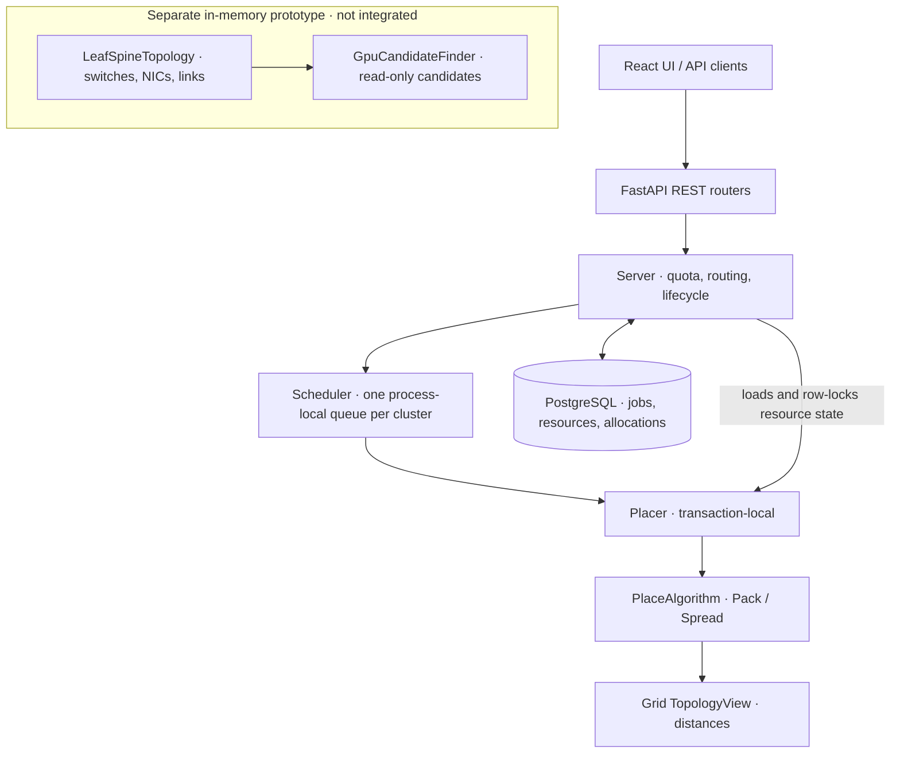
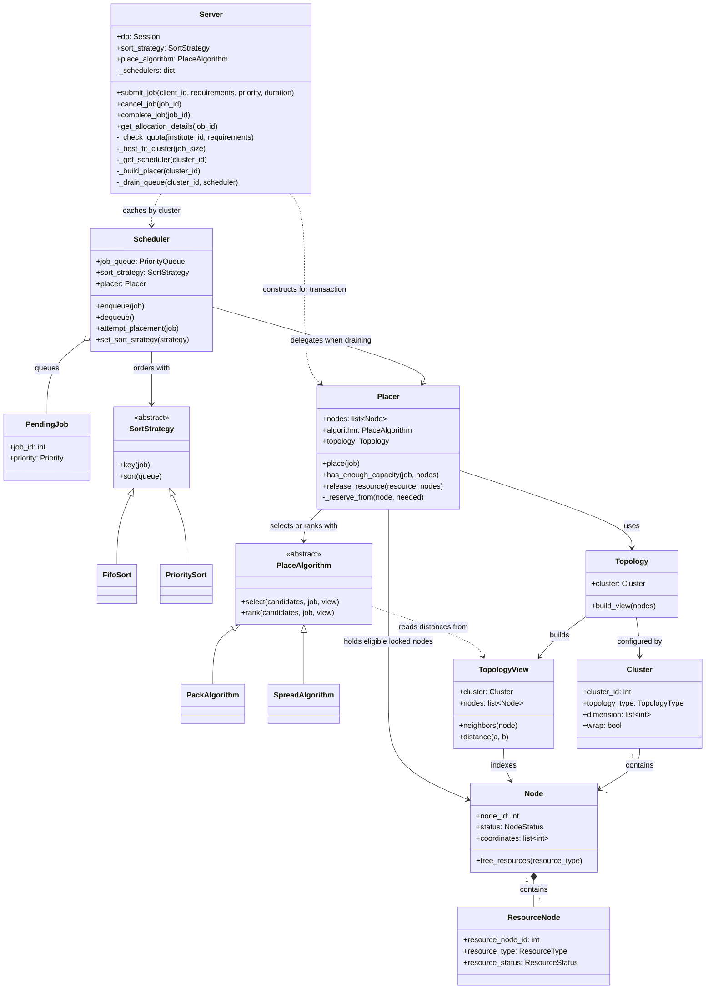
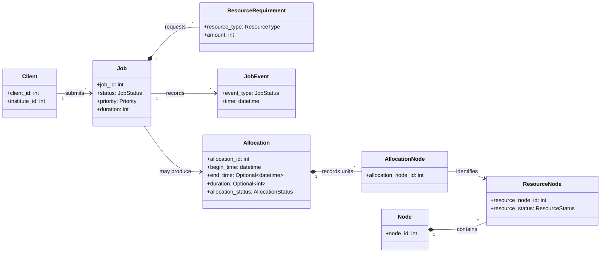

# Architecture

This document describes the **implemented backend**, not the earlier proposed
design in issues #25–#27. The live system uses request-scoped `Server` instances,
process-local queues, transaction-local placement, and SQLAlchemy ORM models.
The independent GPU leaf–spine prototype is deliberately **not** part of the
allocation path yet.

## System boundaries

- **FastAPI routers** accept requests, create a `Server` with the request's
  database session, translate domain errors to HTTP responses, and commit or
  roll back mutations. The ORM `Client` is a persisted user/owner record, **not**
  a network client class with `connect()` and `disconnect()` methods.
- **Server** owns admission, institute-level quotas, cluster routing, reservation
  filtering, allocation/event persistence, and resource release. It queries
  SQLAlchemy models directly; there is **no `AllocationRepository`**.
- **Scheduler** maintains a priority queue of lightweight `PendingJob` references
  (`job_id`, `priority`). One scheduler per cluster is cached in
  `Server._schedulers` for the life of the Python process. Its sorting policy
  selects **which job is attempted next**, not the physical resources.
- **Placer** is constructed when a queue drain needs a placement attempt, using
  the current transaction's row-locked `Node` and `ResourceNode` objects. It
  chooses **which exact resource units** to allocate. It neither queries nor
  commits the database.
- **Topology / TopologyView** describe the coordinate-grid neighborhood and
  distance snapshot used by Pack/Spread. They do not represent leaf–spine
  networking; `FAT_TREE` remains unsupported in the live cluster path.

## Where vs. when

The central design distinction remains:

- **Scheduler answers *when*.** Given a cluster's queued jobs, which job should get the next placement attempt? `SortStrategy` (`PrioritySort` or `FifoSort`) orders the `PendingJob` references; it does not choose resource units.
- **Placer answers *where*.** Given the ORM `Job` selected for an attempt and eligible resources, which precise `ResourceNode` units should be allocated? `PlaceAlgorithm` (`PackAlgorithm` or `SpreadAlgorithm`) ranks candidates using the current topology view.

These decisions are independently swappable. `Server` sits at their boundary: it handles admission and persistence, asks the scheduler for the next job, loads and locks the inventory, applies reservation eligibility, and delegates the physical choice to the placer. Here, *when* means **queue ordering/next attempt**, not a wall-clock start-time guarantee.

## Implemented class diagram: scheduling and placement

The diagram deliberately focuses on executable domain classes and their most
important ORM dependencies. For the implemented persistence relationships, consult the SQLAlchemy
models and Alembic migrations. The [historical ERD](erd.md) needs a separate
[audit (#92)](https://github.com/labo-man002/job-scheduler/issues/92).

`Scheduler.placer` may initially be `None`: `Server._drain_queue()` assigns a
fresh `Placer` only when there is an eligible queued job. The scheduler stores
`PendingJob`, whereas `Placer.place()` receives the **ORM `Job`** freshly loaded
by `Server`. `Placer.place()` returns `list[ResourceNode] | None`, possibly from
**multiple nodes**; it does not return a single `Node`.

### Persisted request and fulfillment

The ORM `ResourceRequirement` is the **request**, while `AllocationNode` is the
**actual fulfillment**. Their separation makes allocation decisions auditable
even for jobs that span nodes. The diagram omits institute policy and other
tables for readability; the ORM models and migrations are authoritative
until the [ERD audit (#92)](https://github.com/labo-man002/job-scheduler/issues/92) is complete.

### Why `Topology` and `TopologyView` are separate

`Topology` holds the cluster's grid configuration. For each placement attempt,
`Placer` builds a `TopologyView` over its **current eligible ORM nodes**;
`TopologyView` indexes their coordinates and supplies distances. Pack/Spread
can therefore score a candidate against occupied nodes (`ALLOCATED` or
`MIXED`) that are not themselves candidates because they lack enough free
resources. This preserves the distinction between **placement eligibility**
and **topology context** within that view.

Today, reservation-excluded nodes are absent from both the candidate set and
the topology view. Whether their physical occupancy should still influence
scoring is an open [design question (#91)](https://github.com/labo-man002/job-scheduler/issues/91);
the documentation PR does not change that behavior.

## From submission to an allocation

1. `POST /jobs` builds a request-scoped `Server`. `submit_job()` loads the
   `Client`, checks that institute's **current-month concurrent-resource quota**,
   and chooses the smallest cluster by **total resource-unit count** that can
   hold the requested total. This routing is a coarse size check, not yet a
   topology-aware or per-resource-type cluster selection.
2. `Server` gets the cluster's cached `Scheduler` (seeding it with persisted
   `QUEUED` jobs on first use), writes the `Job`, `ResourceRequirement` rows and
   `QUEUED` `JobEvent`, and enqueues a `PendingJob` reference.
3. During `_drain_queue()`, the scheduler selects the next reference; `Server`
   reloads the real `Job`, lazily discarding cancelled/stale queue references.
   `Server._build_placer()` locks the cluster's `Node` and `ResourceNode` rows
   with `SELECT ... FOR UPDATE` before asking for placement.
4. For each job, `Server` excludes nodes currently reserved for **other**
   institutes. `Placer` first tries a single eligible node and, when necessary,
   ranks nodes for a multi-node allocation. Pack/Spread use a fresh
   `TopologyView`; the placer marks the chosen individual resource rows
   `ALLOCATED` in the transaction.
5. On success, `Server` creates `Allocation` plus one `AllocationNode` per
   selected `ResourceNode`, marks the job `RUNNING`, and writes its `JobEvent`.
   The FastAPI router commits the transaction. On capacity failure, the job
   remains `QUEUED`, and strict-order draining stops. Reservation-only blocking
   can be skipped temporarily so other institutes are not stalled.

This is **not distributed scheduling**: the queue lives inside one Python
process. `Server._schedulers` is not shared across workers or transactionally
coupled to the database; the persistent job state and the in-memory queue are
separate mechanisms.

### Completion and cancellation

`Server.complete_job()` and cancellation of a running job both invoke
`_end_running_job()`: release the exact resources referenced by
`AllocationNode`, set actual allocation end time/duration and status, append a
job event, then attempt another queue drain for the freed cluster. A cancelled
**queued** job is marked `CANCELLED` in the database and its stale heap entry
is discarded later. A resource on a `DOWN` node returns to `UNAVAILABLE`, not
`AVAILABLE`, when released.

## Persistence and policy boundary

| Concept | Implemented responsibility |
| --- | --- |
| `Client` / `Institute` | Persisted ownership; multiple clients may share institute policy. |
| `Quota` | Per-institute, per-resource-type **live concurrency cap**, selected by calendar month; checked at submission. It is not GPU-hours accounting or hierarchical fair share. |
| `Reservation` / `NodeReservation` | Time-bounded institute rights to nodes, applied as per-job candidate exclusions before placement; no preemption. |
| `Job` / `ResourceRequirement` | Requested work, lifecycle status and requested amounts; jobs do not persist a cluster assignment. |
| `Node` / `ResourceNode` | Authoritative compute inventory and individual CPU/GPU availability. |
| `Allocation` / `AllocationNode` | Persisted fulfillment: links a job to every actual resource unit, including multi-node allocations. |
| `JobEvent` | Persisted status-transition history; independent of ephemeral application logs. |

There is currently no usage-metering writer for `ResourceUsage`, no
gang-scheduling or preemption layer, and no policy engine for borrowing or
reclaiming quota. Those are potential future extensions, not live components.

## Independent GPU leaf–spine model

`backend/app/domain/leaf_spine/` implements immutable switch/port/NIC/server
snapshots, canonical physical links, operational-state changes, constrained
path discovery, and `GpuCandidateFinder`. A `GpuServer` has one NIC and maps to
an existing ORM `Node.node_id`; the finder receives ORM nodes supplied by its
caller and only **reads** `ResourceType.GPU` availability and network paths.

Crucially, neither `Server._build_placer()` nor `Placer.place()` instantiates
`LeafSpineTopology` or calls `GpuCandidateFinder`. There is no persistence for
fabric devices or links, bandwidth reservation, contention model, NVLink/
NVSwitch entity, or NVSwitch-aware GPU placement. The separate model and its
own detailed class diagram live in [GPU leaf–spine design](gpu-leaf-spine.md).

## Code map

- [REST routers](../backend/app/routers/jobs.py) — HTTP/session commit boundary.
- [Server](../backend/app/domain/server.py) — policy, cluster routing, persistence and draining.
- [Scheduler](../backend/app/domain/scheduler.py) and [sort strategies](../backend/app/domain/sort_strategy.py) — queue ordering.
- [Placer](../backend/app/domain/placer.py), [placement algorithms](../backend/app/domain/place_algorithm.py) and [grid topology](../backend/app/domain/topology.py) — resource-unit selection.
- [Leaf–spine prototype](gpu-leaf-spine.md) — standalone network feasibility model.
- [Historical ERD](erd.md) ([audit #92](https://github.com/labo-man002/job-scheduler/issues/92)) and [decisions](decisions.md) — schema history and modeling tradeoffs; current ORM models/migrations are authoritative.
