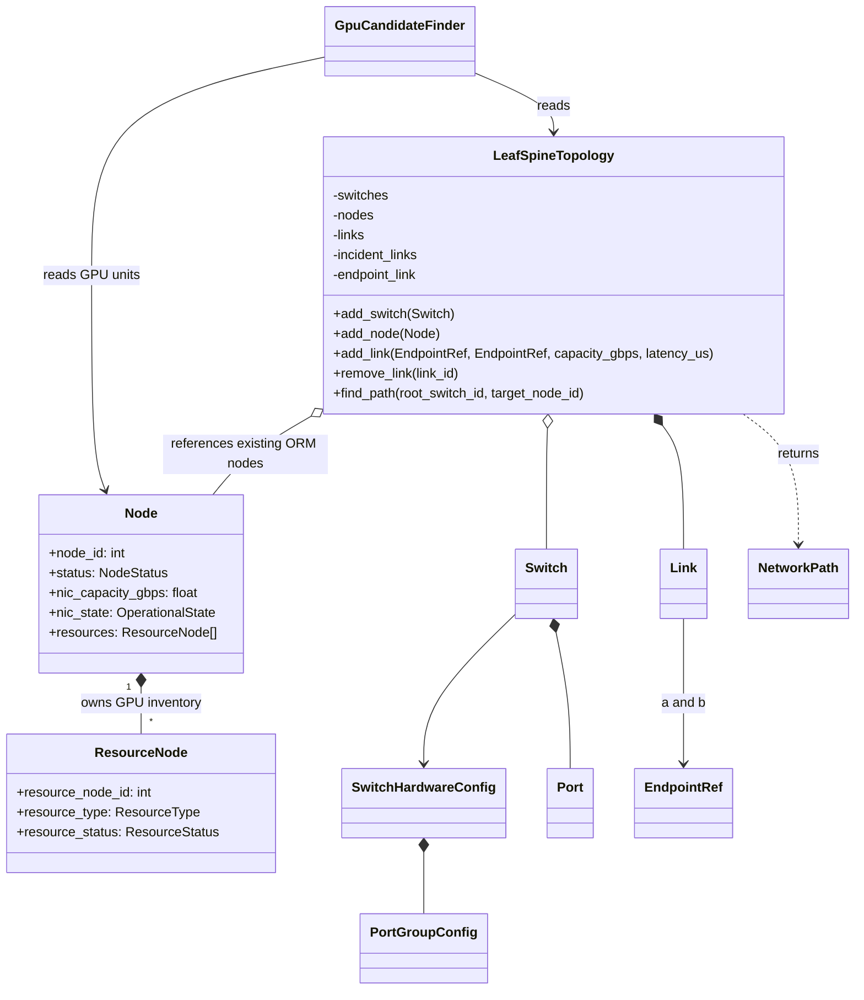

# GPU leaf–spine fabric (v1, in-memory)

This module is an **in-memory domain prototype**. It does not enable
`TopologyType.FAT_TREE`, change the coordinate-grid `TopologyView`, create
persistent switch/link tables, or reserve GPUs or network bandwidth. Existing
`Node` and `ResourceNode` remain the single source of truth for compute hosts
and allocatable GPU units.

The agreed representation is direct: **a physical compute server is its
existing ORM `Node`**, and that same `Node` is registered as the network
endpoint attached to a leaf. There is no `GpuServer` wrapper or duplicate
server identity. GPU inventory remains on `Node.resources` as
`ResourceNode` rows.

## Model and ownership



`LeafSpineTopology` owns connectivity mutations. The immutable `Link` values
in its private `_links` registry are canonical. `_incident_links` and
`_endpoint_link` are derived lookup indexes. The topology holds references to
the caller's existing ORM `Node` objects; it does not create, persist, or
mutate Nodes or their ResourceNodes. The application/database session owns
their lifecycle and state.

Switches own generated one-based ports from an immutable Python hardware config
(shared across leaf and spine roles). A registered Node exposes one network
endpoint, `nic0`, whose capacity and state come from `Node.nic_capacity_gbps`
and `Node.nic_state`. NIC capacity is optional on ordinary Nodes; a Node
without a configured capacity cannot be attached to the fabric. Host
availability comes from the existing `Node.status`: `NodeStatus.DOWN`
makes paths unusable. NIC-down state also makes the NIC path unusable.
Allowed pairs are LEAF↔SPINE and NODE↔LEAF. Disconnected or partially wired
fabrics are valid.

A DOWN component (switch, port, link, Node, or Node NIC) makes a path unusable,
but **does not** erase its physical connection or make the endpoint available
for another cable. `get_neighbors(..., operational_only=False)` describes
wiring; `operational_only=True` describes operational connectivity.

## Example

```python
from app.domain.leaf_spine import (
    DeviceKind, EndpointRef, LeafSpineTopology,
    PortGroupConfig, Switch, SwitchHardwareConfig, SwitchRole,
)
from app.enums import NodeStatus
from app.enums.operationalState import OperationalState
from app.models.node import Node

config = SwitchHardwareConfig("demo-4x400", (PortGroupConfig(4, 400),))
fabric = LeafSpineTopology()
fabric.add_switch(Switch("leaf-a", SwitchRole.LEAF, config))
fabric.add_switch(Switch("spine-1", SwitchRole.SPINE, config))

# In the application, this is an existing ORM Node in the current DB session.
node = Node(
    node_id=42, cluster_id=1, coordinates=[0],
    status=NodeStatus.IDLE,
    nic_capacity_gbps=100, nic_state=OperationalState.UP,
)
fabric.add_node(node)

sw = lambda sid, n: EndpointRef(DeviceKind.SWITCH, sid, f"p{n}")
nic = EndpointRef(DeviceKind.NODE, "42", "nic0")
fabric.add_link(sw("leaf-a", 1), sw("spine-1", 1), capacity_gbps=400, latency_us=2)
fabric.add_link(sw("leaf-a", 2), nic, capacity_gbps=100, latency_us=1)

path = fabric.find_path("spine-1", 42, min_link_capacity_gbps=100)
assert path.link_ids == ("link-1", "link-2")
assert path.total_latency_us == 3
```

GPU discovery (optional read-only query, **not placement**):

```python
from app.domain.leaf_spine import GpuCandidateFinder

# Use the same session-loaded Node instances that were registered with fabric.
candidates = GpuCandidateFinder(fabric).find_candidates(
    "spine-1", [node], min_free_gpus_per_node=2,
    min_link_capacity_gbps=100, max_total_latency_us=10,
)
```

## API and invariants

- `add_node(node)` registers a persisted ORM Node by its `node_id`. The
  supplied Node must have a nonnegative integer ID. Duplicate Node IDs are
  rejected. `add_node` requires no second ID or server wrapper.
- `_resolve_endpoint()` accepts a Node's `nic0` only when its NIC capacity is
  configured. Link capacity cannot exceed either endpoint's nominal capacity.
- `validate_connection(a, b, *, capacity_gbps, latency_us, link_id=None)`
  checks endpoints, role compatibility, capacity, latency, physical occupancy
  and link ID without mutating the topology; it returns the resulting
  `LinkKind`.
- `add_link(a, b, *, capacity_gbps, latency_us, link_id=None)` calls
  `validate_connection()` before constructing and registering the frozen
  `Link`. Duplicate IDs or invalid registrations raise typed errors.
- `remove_link()` frees both endpoints and graph indexes; removing a connected
  switch or Node is rejected, not cascaded.
- `set_link_state`, `set_switch_state`, and `set_port_state` replace network
  snapshots under topology control. Node host/NIC states are updated on the ORM
  Node by the application layer, not through the topology.
- `switches()`, `nodes()`, `links()`, `get_neighbors()` (neighbor switch ID
  and connecting Link pairs), `connected_nodes()` and
  `find_link_by_endpoint()` expose read-only collections/snapshots where
  appropriate.
- `find_path(root_switch_id, target_node_id, ...)` returns
  `NetworkPath | None` for known endpoints. It uses Dijkstra over operational
  bidirectional links, excludes other compute Nodes as transit, filters by
  **nominal** per-link capacity, and minimizes summed latency. Ties prefer
  fewer hops, then lexical sequences of link IDs. A latency threshold includes
  the final NIC access link. A returned path is an instantaneous snapshot,
  not a reservation.
- `GpuCandidateFinder` reads `Node.free_resources(ResourceType.GPU)` and
  excludes `NodeStatus.DOWN`. The Node objects supplied to the finder must be
  the same ORM instances registered in the topology and must cover its
  registered Nodes. It does not mutate, flush, persist, or query anything.
  Results are sorted by path latency, then Node ID.
- `validate_structure()` reports nonfatal missing-uplink/attachment
  diagnostics. Partial graphs remain legal.

## Deliberately deferred integration

1. Persist switches, endpoints, physical links and Node attachment in a
   reviewed schema migration; add a **separate** leaf–spine topology type rather
   than treating the existing `FAT_TREE` stub as implemented. Coordinate grids
   should not be overloaded with network switch IDs.
2. Build a transaction-local fabric snapshot in `Server._build_placer` and
   extend `Placer`/`PlaceAlgorithm` contracts to support network-aware policy,
   preserving the project's `SELECT ... FOR UPDATE` resource allocation
   safety, quota/reservation behavior and strict queue ordering.
3. Add atomic multi-server GPU allocation and explicit residual-bandwidth
   reservations. v1 path feasibility does not account for contention,
   ECMP/routing decisions, GPU model, NVLink, racks or multi-NIC hosts.

Run `PYTHONPATH=. pytest -v` and `ruff check .` in `backend/`. Existing grid
placement tests must continue to pass unchanged.
