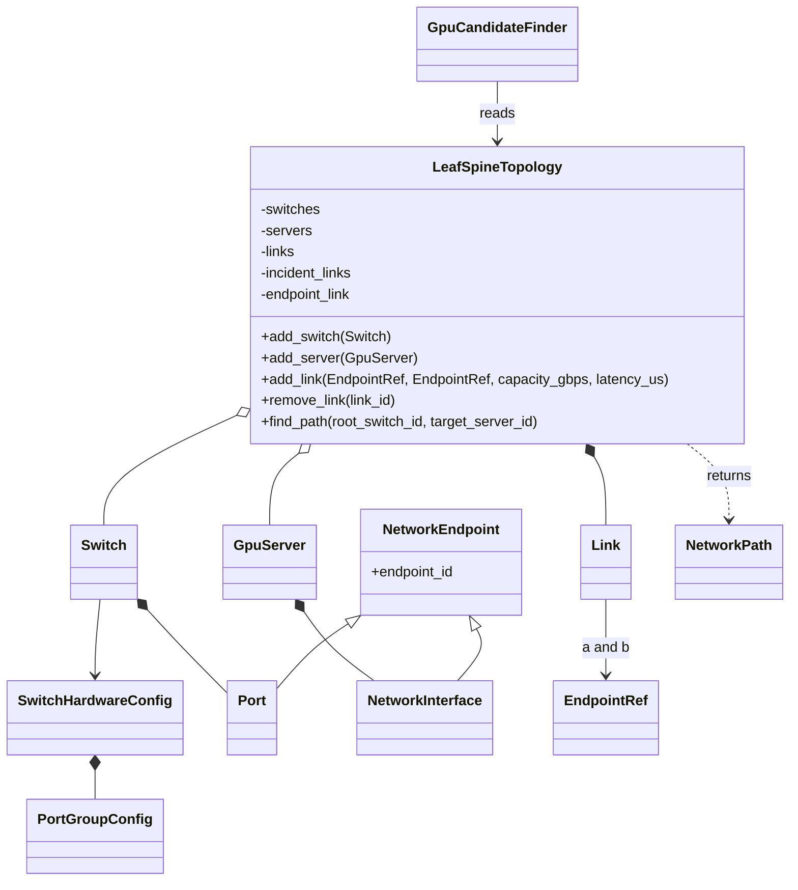

# GPU leaf–spine fabric (v1, in-memory)

This module is intentionally a **separate domain-only prototype**. It does not enable
`TopologyType.FAT_TREE`, change the coordinate-grid `TopologyView`, create SQL tables,
or reserve GPUs/network bandwidth. Existing `Node` and `ResourceNode` remain the
source of truth for GPU allocation state.

## Model and ownership



`LeafSpineTopology` owns connectivity mutations. The immutable `Link` values in its
private `_links` registry are canonical. `_incident_links` and `_endpoint_link`
are derived indexes, not separate facts about link configuration. Returned
switches, ports, servers, links, paths and candidates are immutable snapshots;
updates go through topology methods.

Switches own generated one-based ports from an immutable Python hardware config
(shared across leaf and spine roles). A `GpuServer` has one `nic0` and maps to an
existing ORM `Node.node_id` (without storing GPU availability). Each endpoint
may have one physical link, but two devices may have parallel links using
different ports. Allowed pairs are LEAF↔SPINE and GPU_SERVER↔LEAF.
Disconnected or partially wired fabrics are valid.

A DOWN component (switch, port, link, server or NIC) makes a path unusable, but
**does not** erase its physical connection or make the endpoint available for
another cable. `get_neighbors(..., operational_only=False)` describes wiring;
`operational_only=True` describes operational connectivity.

## Example

```python
from app.domain.leaf_spine import (
    DeviceKind, EndpointRef, GpuServer, LeafSpineTopology,
    PortGroupConfig, Switch, SwitchHardwareConfig, SwitchRole,
)

config = SwitchHardwareConfig("demo-4x400", (PortGroupConfig(4, 400),))
fabric = LeafSpineTopology()
fabric.add_switch(Switch("leaf-a", SwitchRole.LEAF, config))
fabric.add_switch(Switch("spine-1", SwitchRole.SPINE, config))
fabric.add_server(GpuServer("gpu-a", node_id=42, nic_capacity_gbps=100))

sw = lambda sid, n: EndpointRef(DeviceKind.SWITCH, sid, f"p{n}")
nic = EndpointRef(DeviceKind.GPU_SERVER, "gpu-a", "nic0")
fabric.add_link(sw("leaf-a", 1), sw("spine-1", 1), capacity_gbps=400, latency_us=2)
fabric.add_link(sw("leaf-a", 2), nic, capacity_gbps=100, latency_us=1)

path = fabric.find_path("spine-1", "gpu-a", min_link_capacity_gbps=100)
assert path.link_ids == ("link-1", "link-2")
assert path.total_latency_us == 3
```

GPU discovery (optional read-only query, **not placement**):

```python
from app.domain.leaf_spine import GpuCandidateFinder

# nodes: list[app.models.Node] loaded by the existing transaction owner.
# Every registered GpuServer.node_id must have a matching Node in `nodes`.
candidates = GpuCandidateFinder(fabric).find_candidates(
    "spine-1", nodes, min_free_gpus_per_server=2,
    min_link_capacity_gbps=100, max_total_latency_us=10,
)
```

## API and invariants

- `validate_connection(a, b, *, capacity_gbps, latency_us, link_id=None)` checks
  endpoints, role compatibility, capacity, latency, physical occupancy and link ID
  without mutating the topology; it returns the resulting `LinkKind`.
- `add_link(a, b, *, capacity_gbps, latency_us, link_id=None)` calls
  `validate_connection()` before constructing and registering the frozen `Link`.
  Duplicate IDs or invalid registrations raise typed errors.
- `remove_link()` frees both endpoints and graph indexes; removing a connected
  device is rejected, not cascaded.
- `set_link_state`, `set_switch_state`, `set_port_state`, `set_server_state`,
  `set_nic_state` replace immutable snapshots under topology control.
- `switches()`, `servers()`, `links()`, `get_neighbors()` (neighbor switch ID and
  connecting `Link` pairs),
  `connected_servers()` and `find_link_by_endpoint()` do not expose mutable
  internal registries.
- `find_path()` returns `NetworkPath | None` for known endpoints. It uses
  Dijkstra over operational bidirectional links, excludes other GPU servers as
  transit, filters by **nominal** per-link capacity, and minimizes summed
  latency. Ties prefer fewer hops, then lexical sequences of link IDs.
  A latency threshold includes the final NIC access link. Returned path
  information is an instantaneous immutable snapshot, not a reservation.
- `GpuCandidateFinder` uses `Node.free_resources(ResourceType.GPU)` and
  excludes `NodeStatus.DOWN`. It does not mutate or persist anything. Missing
  node IDs or duplicates in its supplied inventory are errors. Results are
  sorted by path latency, then compute node ID, then server ID.
- `validate_structure()` reports nonfatal missing-uplink/attachment diagnostics.

## Deliberately deferred integration

1. Persist switches, endpoints, physical links and Node attachment in a
   reviewed schema migration; add a **separate** leaf–spine topology type rather
   than treating the existing `FAT_TREE` stub as implemented. Coordinate grids
   should not be overloaded with network switch IDs.
2. Build a transaction-local fabric snapshot in `Server._build_placer` and
   extend `Placer`/`PlaceAlgorithm` contracts to support network-aware policy,
   preserving the project's `SELECT ... FOR UPDATE` resource allocation
   safety, quota/reservation behavior and strict queue ordering.
3. Add atomic multi-server GPU allocation and explicit residual-bandwidth
   reservations. v1 path feasibility does not account for contention,
   ECMP/routing decisions, GPU model, NVLink, racks or multi-NIC servers.

Run `PYTHONPATH=. pytest -v` and `ruff check .` in `backend/`. Existing grid
placement tests must continue to pass unchanged.
